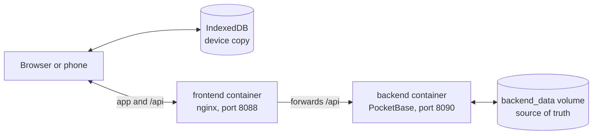

# Veylith

A workout planner and tracker: a React PWA (Vite + React + TypeScript, Zustand) with accounts and a PocketBase backend. Data lives in the backend, and each device keeps a copy in IndexedDB so workouts carry on without a connection.



## Structure

```
frontend/      React app and its container
backend/       PocketBase container, migrations and hooks
docs/          Documentation
compose.yaml   All containers
stack.sh       Manages the containers
```

Each new container gets its own top-level folder.

## Run

In containers, with the app at http://localhost:8088 and the backend dashboard at http://localhost:8090/_/:

```bash
./stack.sh start     # start everything
./stack.sh rebuild   # rebuild and restart after code changes
./stack.sh status    # health, URLs, CPU and memory
./stack.sh urls      # service URLs
./stack.sh logs      # follow logs
./stack.sh down      # stop and remove everything (data is kept)
./stack.sh help      # list all commands
```

Create a backend admin once, and back up the database whenever you like:

```bash
./stack.sh pb admin you@example.com
./stack.sh pb backup
```

On Windows, run it from Ubuntu in WSL with Docker Desktop closed (see [Containers](docs/containers.md)).

For frontend development, at http://localhost:5173, with the backend container running:

```bash
cd frontend
npm install
npm run dev
npm run build
```

## Docs

- [Features](docs/features.md)
- [Containers](docs/containers.md)
- [Backend](docs/backend.md)
