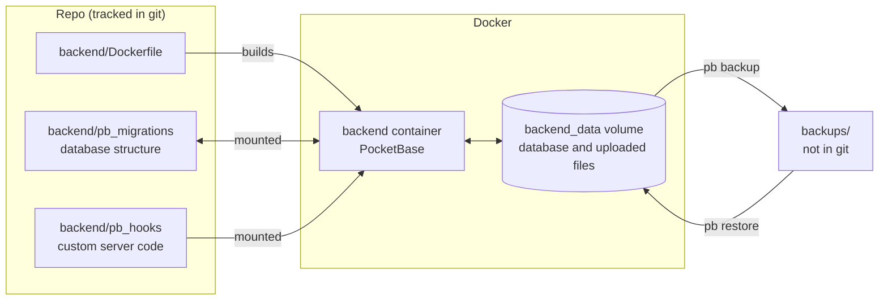
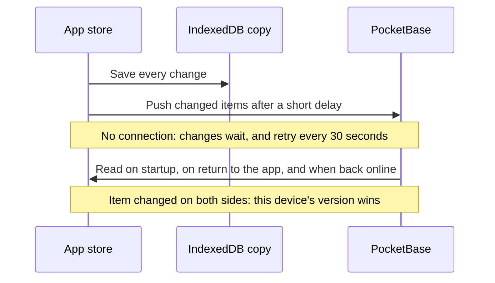
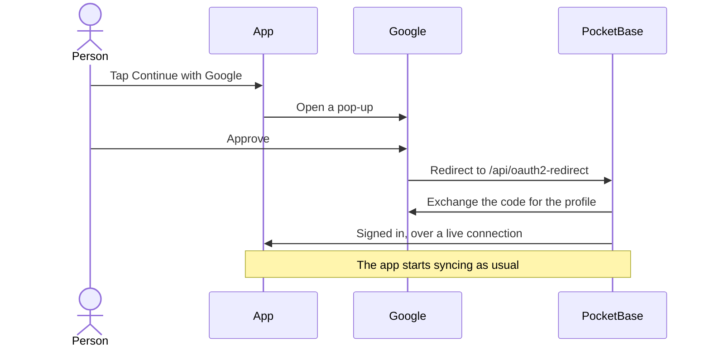
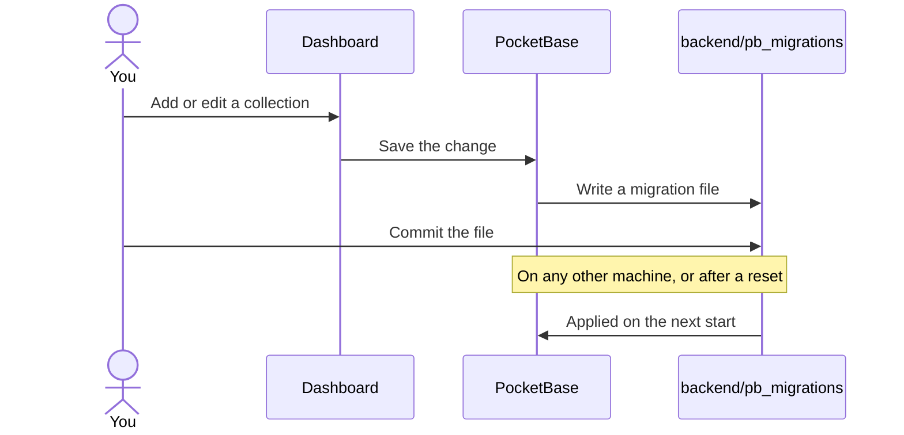
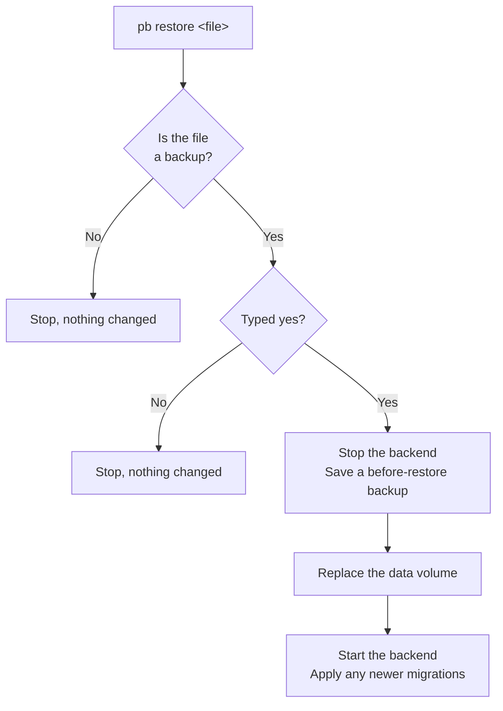

# Backend

The backend is [PocketBase](https://pocketbase.io) in its own container. It holds every account's data in a SQLite database, and provides sign-in, a REST API, file storage and an admin dashboard.

| Address | What it is |
| --- | --- |
| http://localhost:8090/_/ | Admin dashboard, on this machine only |
| http://localhost:8088/api/ | API, as the app reaches it through the frontend's nginx |
| http://localhost:8090/api/ | API, directly |
| http://backend:8090 | The API, from other containers |

## How it fits together

Each part can change without touching the others. Rebuilding replaces only the container.



## First run

```bash
./stack.sh start
./stack.sh pb admin you@example.com
```

Then sign in to the dashboard. The password needs at least 10 characters. This admin login is separate from the accounts people create in the app.

## What's stored

Each collection has one row per item, and each row belongs to one user. `key` is the app's id for the item and `data` is the item as JSON. Rules limit every user to their own rows, and deleting an account deletes them.

| Collection | Holds |
| --- | --- |
| `users` | Accounts: email, name and profile picture |
| `sessions` | Finished workouts |
| `routines` | Programs and their days |
| `exercises` | Custom exercises |
| `programs` | Curated and imported programs |
| `body_stats` | Body measurements |
| `photos` | Progress photos, with the image in the `image` field |
| `scheduled_days` | Workouts planned for a date |
| `exercise_records` | Best lifts and targets |
| `user_state` | Settings, active program, workout in progress |

## How the app syncs

PocketBase is the source of truth. Each signed-in device keeps a working copy in IndexedDB, so a workout carries on without signal.



- **First sign-in on a device:** an empty account takes everything on the device. An account that already has data keeps it, and only workouts, body stats and photos from the device are added.
- **Conflicts:** the rule applies per item, so two devices editing different workouts never clash. If both edit the same one, the device that syncs last wins.
- **Signing out:** the device's copy is removed once everything has reached the server. If something hasn't, the app asks first.
- **Expired sign-in:** the device keeps its copy and any waiting changes for the next sign-in.

The code is in `frontend/src/lib/sync.ts`, with the merge rules in `syncMerge.ts`.

To point a build at a different server, set `VITE_API_URL` when building. Otherwise the app uses its own address.

## Google sign-in

*Continue with Google* appears once `GOOGLE_CLIENT_ID` and `GOOGLE_CLIENT_SECRET` are set. Email and password sign-in keeps working alongside it. Set these in `.env`, not the dashboard: `backend/pb_hooks/google_auth.pb.js` applies them at every start and replaces any Google settings made there.

1. In the [Google Cloud Console](https://console.cloud.google.com/), create a project.
2. Under **Google Auth Platform**, fill in the branding, choose **External** as the audience, and add yourself as a test user.
3. Under **Clients**, create a **Web application** client with these redirect URIs:
   ```
   http://localhost:8088/api/oauth2-redirect
   http://localhost:5173/api/oauth2-redirect
   ```
4. Put the client ID and secret in `.env`, then run `./stack.sh start backend`.

While the app is in Google's testing mode, only listed test users can sign in. Publish it under **Audience** to open it to everyone.

Google only accepts `http://` redirects on `localhost`. A real domain needs HTTPS, plus its own redirect URI added to the client, for example `https://example.com/api/oauth2-redirect`. That also applies to phones on your network, which can't use `localhost`.



New accounts take their name and picture from Google. An email already in use joins that account when Google has confirmed the address, and any password set on an unverified account stops working, so nobody can claim an address in advance. An unconfirmed Google address is refused.

A backup includes the client secret, because PocketBase stores it in the database. The secret is applied from `.env` at every start, so changing it there is enough.

## Profiles

Name and picture are on the `users` collection. People set them when signing up or in Settings, and pictures are resized to 512 pixels with location data removed. Each account can only read its own `users` row. Showing people to each other, for example in a group, means widening the `users` view rule along with the app data rules.

## Changing the database

The structure of the database lives in `backend/pb_migrations`, so it's reviewed and rolled back like code. PocketBase applies new migrations each time it starts.



To write one by hand instead:

```bash
./stack.sh pb migrate create add_workouts   # creates the file to edit
./stack.sh restart backend                  # applies it
./stack.sh pb migrate down 1                # undoes the last one
```

For custom server code, add `*.pb.js` files to `backend/pb_hooks` and run `./stack.sh restart backend`.

## Backups

| Command | What it does |
| --- | --- |
| `./stack.sh pb backup [name]` | Save the database to `backups/` |
| `./stack.sh pb restore` | List backups |
| `./stack.sh pb restore <file>` | Replace the database with a backup |
| `./stack.sh pb reset` | Erase the database |

This database now holds everyone's real data, so back it up regularly and keep copies off this machine. Backups stop the backend for a moment so the files are copied in a consistent state. `backups/` is ignored by git because it holds real user data.

`restore` and `reset` both ask you to type `yes` and save a backup first, named `before-restore-…` or `before-reset-…`. After a reset the structure comes back from the migrations, but the data and admin accounts are gone, so run `pb admin` again.



## Changing the setup

Copy `.env.example` to `.env` to change any of these:

| Setting | Default | What it does |
| --- | --- | --- |
| `BACKEND_PORT` | `8090` | Port on your machine |
| `BACKEND_HOST` | `127.0.0.1` | Set to `0.0.0.0` to allow other devices on your network |
| `BACKEND_ORIGINS` | `http://localhost:8088,http://localhost:5173` | Sites allowed to call the API from a browser |
| `POCKETBASE_VERSION` | `0.40.6` | Run `./stack.sh rebuild backend` after changing it |

Before moving to a new PocketBase version, take a backup and read the [release notes](https://github.com/pocketbase/pocketbase/releases), since new versions can change how data is stored.

PocketBase only supports SQLite. Moving to a database like PostgreSQL means replacing the `backend` service with a different server, not changing a setting. In the app, that would touch `lib/pb.ts`, `lib/sync.ts`, the photo download in `lib/photos.ts` and the `Login` and `Settings` screens.

Password reset emails aren't set up: they need a mail server, configured in the dashboard under Settings → Mail settings, and a reset screen in the app.
