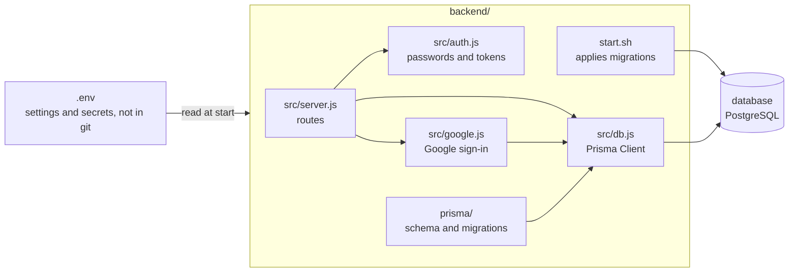
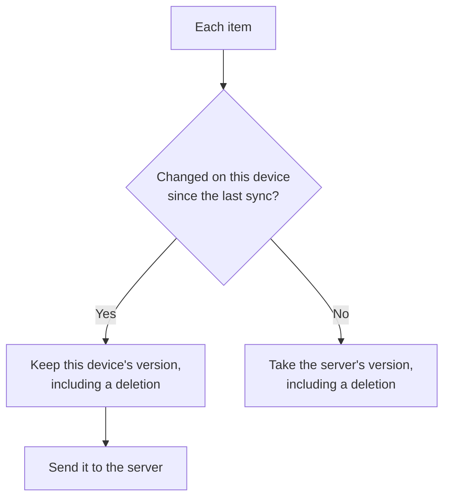
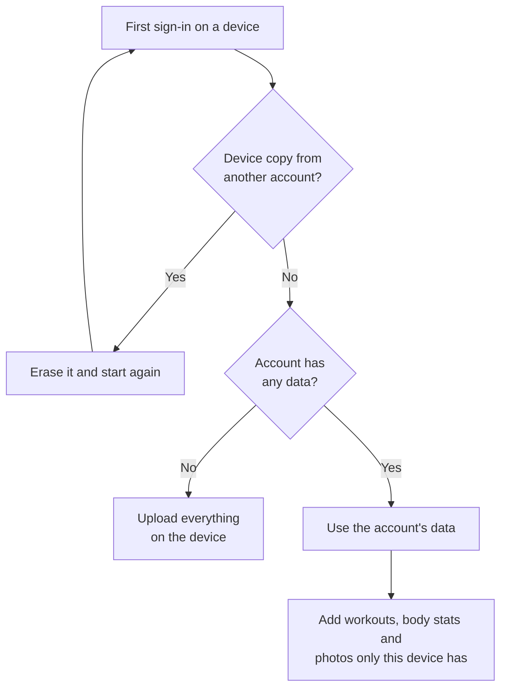
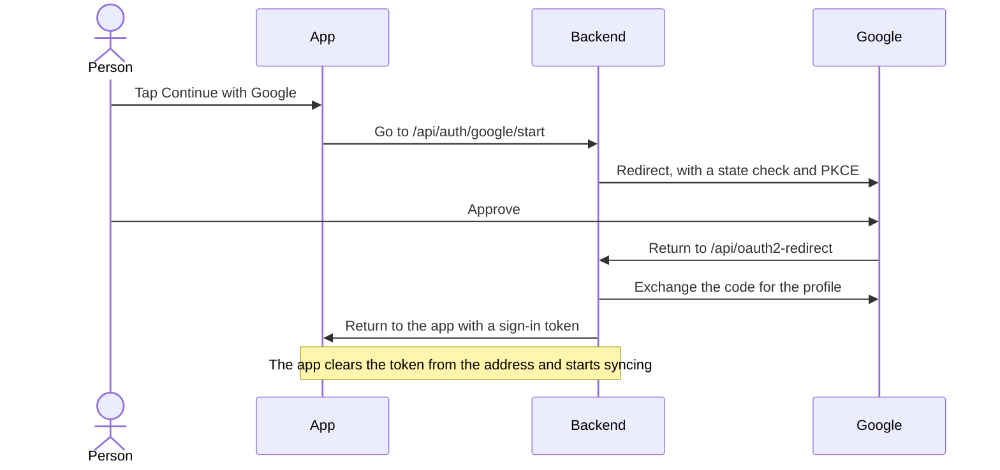
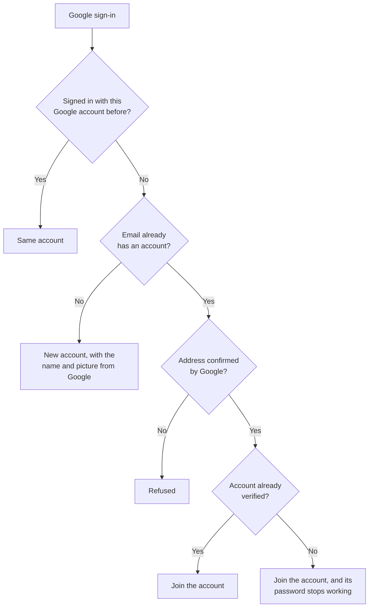

# Backend

The backend is a small Node.js API (Fastify) in its own container. It handles sign-in, sync and files, and it's the only part of the app that talks to the [database](database.md). You can also reach the database yourself from this machine, with Prisma Studio or your own database app.

| Address | What it is |
| --- | --- |
| http://localhost:8088/api/ | API, as the app reaches it through the frontend's nginx |
| http://localhost:8090/api/ | API, directly, on this machine only |
| http://backend:8090 | The API, from other containers |

## How it fits together



On the app side, every call to the backend is in `frontend/src/lib/api.ts`. On the database side, every query goes through Prisma Client from `src/db.js`. The structure is described in [Database](database.md).

## API

Routes marked with a tick need a signed-in user, and only ever touch that user's data.

| Route | | What it does |
| --- | --- | --- |
| `GET /api/health` | | Check the backend and database |
| `GET /api/auth/methods` | | Whether Google sign-in is on |
| `POST /api/auth/register` | | Create an account |
| `POST /api/auth/login` | | Sign in |
| `GET /api/auth/google/start` | | Start Google sign-in |
| `GET /api/oauth2-redirect` | | Finish Google sign-in |
| `GET /api/auth/me` | ✓ | Current account, with a fresh token |
| `PATCH /api/auth/me` | ✓ | Change name |
| `PUT` or `DELETE /api/auth/me/avatar` | ✓ | Change or remove profile picture |
| `GET /api/avatars/:id` | | A profile picture, by its random id |
| `GET /api/sync` | ✓ | All of the user's items |
| `PUT` or `DELETE /api/items/:collection/:key` | ✓ | Save or delete an item |
| `PUT` or `GET /api/photos/:key` | ✓ | Save or read a progress photo |

Passwords are hashed with scrypt. Sign-in tokens last 30 days and renew whenever the app opens. Sign-in and sign-up allow 10 tries a minute from one address.

## How the app syncs

The database is the source of truth. Each signed-in device keeps a working copy in IndexedDB, so a workout carries on without signal.


Each sync compares every item with the version both sides last agreed on:



The rule applies per item, so two devices editing different workouts never clash. If both edit the same one, the device that syncs last wins.

The first sign-in on a device has nothing to compare against, so it follows different rules:



- **Signing out:** the device's copy is removed once everything has reached the server. If something hasn't, the app asks first.
- **Expired sign-in:** the device keeps its copy and any waiting changes for the next sign-in.
- **A rejected item:** it's retried later, and the rest carry on.

The code is in `frontend/src/lib/sync.ts`, with the merge rules in `syncMerge.ts`.

The app calls the API at its own address. To point a build at a different server, set `VITE_API_URL` when building, for example `VITE_API_URL=https://api.example.com npm run build` in `frontend/`. The frontend container doesn't pass this setting through yet, so it always uses its own address.

## Google sign-in

*Continue with Google* appears once `GOOGLE_CLIENT_ID` and `GOOGLE_CLIENT_SECRET` are set. Email and password sign-in keeps working alongside it.

1. In the [Google Cloud Console](https://console.cloud.google.com/), create a project.
2. Under **Google Auth Platform**, fill in the branding, choose **External** as the audience, and add yourself as a test user.
3. Under **Clients**, create a **Web application** client with these redirect URIs:
   ```
   http://localhost:8088/api/oauth2-redirect
   http://localhost:5173/api/oauth2-redirect
   ```
4. Put the client ID and secret in `.env`, then run `./stack.sh start backend`.

While the app is in Google's testing mode, only listed test users can sign in. Publish it under **Audience** to open it to everyone.

Google only accepts `http://` redirects on `localhost`. A real domain needs HTTPS, plus its own redirect URI added to the client, for example `https://example.com/api/oauth2-redirect`. That also applies to phones on your network, which can't use `localhost`.



New accounts take their name and picture from Google. The picture is copied into the database when the account is created, so later Google changes don't carry over.



Email sign-up doesn't verify addresses, so every email account counts as unverified here: nobody can claim someone else's address in advance, but a person who signs up by email and later uses Google loses their password sign-in. They keep the account and its data.

## Profiles

The name is on the `users` table, and the picture is in the `files` table, linked by `users.avatar_id`. People set both when signing up or in Settings, and uploaded pictures are resized to 512 pixels with location data removed.

Each account can only read its own data. Showing people to each other, for example in a group, means new tables and routes that check group membership.

## Changing the setup

Copy `.env.example` to `.env` to change any of these. `stack.sh` does this on first use and fills in the secrets.

| Setting | Default | What it does |
| --- | --- | --- |
| `BACKEND_PORT` | `8090` | Port on your machine |
| `BACKEND_HOST` | `127.0.0.1` | Set to `0.0.0.0` to allow other devices to reach the API directly |
| `JWT_SECRET` | Generated | Signs sign-ins. Changing it signs everyone out |
| `GOOGLE_CLIENT_ID`, `GOOGLE_CLIENT_SECRET` | Empty | Turn on Google sign-in |
| `GOOGLE_AUTH_URL`, `GOOGLE_TOKEN_URL`, `GOOGLE_USERINFO_URL` | Google's | Point Google sign-in at a stand-in server, for testing only |

After changing a setting, run `./stack.sh start backend`. `restart` keeps the old settings.

To add a route, add it to `backend/src/server.js` and run `./stack.sh rebuild backend`. If it needs new tables or columns, change `backend/prisma/schema.prisma` and run `./stack.sh db migrate <name>` first. The backend can be replaced by anything that serves the same routes, or by changing `frontend/src/lib/api.ts` to match a new one.

Password reset isn't built: it needs an email service and a reset screen.
