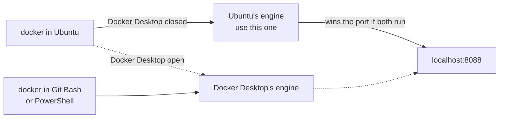
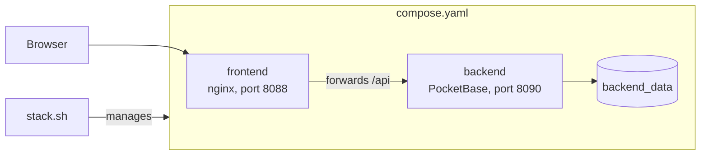
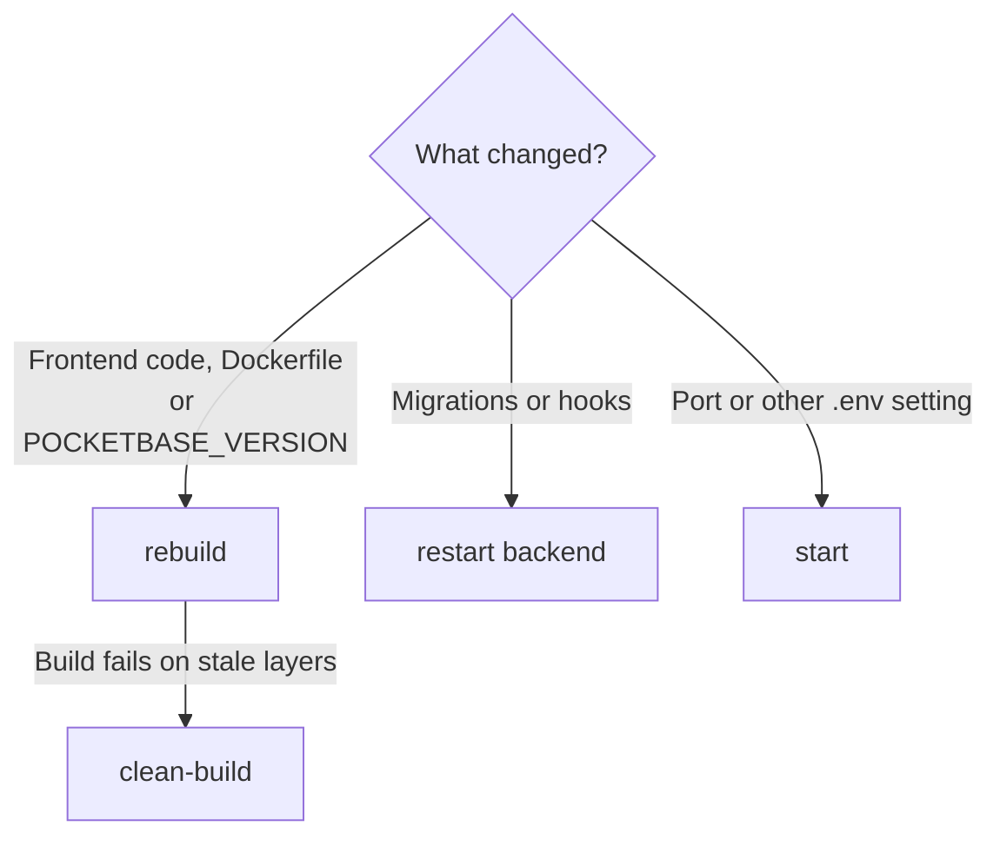

# Containers

Every container is defined in `compose.yaml` at the repo root and managed with `stack.sh`. Docker must be running.

On Windows, run it from Ubuntu in WSL with Docker Desktop closed, so it uses the Docker engine installed in Ubuntu. Stick to one engine: Docker Desktop is a separate engine, so running the script from both starts two copies of a service on the same port, and `localhost` can keep showing the older one. While Docker Desktop is open with WSL integration on, `docker` in Ubuntu reaches Docker Desktop instead of Ubuntu's engine. Run `docker info --format '{{.Name}}'` to see which one you're on.

## The stack

## Running

| Command | What it does |
| --- | --- |
| `./stack.sh start [services]` | Start, building only if an image is missing |
| `./stack.sh stop [services]` | Stop containers but keep them |
| `./stack.sh restart [services]` | Restart without rebuilding |
| `./stack.sh down [services]` | Stop and remove containers (volumes are kept) |

## Building

| Command | What it does |
| --- | --- |
| `./stack.sh rebuild [services]` | Rebuild images and restart with the changes |
| `./stack.sh clean-build [services]` | Rebuild from scratch, ignoring the build cache |

Use `rebuild` after changing code. `start` and `restart` keep running the existing image.

None of these touch the data in a volume. Only `./stack.sh pb reset` and `./stack.sh pb restore` do.

## Monitoring

| Command | What it does |
| --- | --- |
| `./stack.sh status` | Show health, URLs, CPU and memory |
| `./stack.sh urls` | Show the URL of each service |
| `./stack.sh logs [services]` | Follow logs, for one service or all of them |
| `./stack.sh save-logs [services]` | Write each service's logs to `logs/<service>.log` |

`save-logs` overwrites the previous file for that service. The `logs/` folder is ignored by git.

`urls` also runs after `start`, `rebuild` and `clean-build`. `URL` is the address on your machine, and `-` means the service has no published port. `INTERNAL` is the address other containers use. Every port is shown as `http://`, so a database appears that way too even though it doesn't speak HTTP.

## Other

| Command | What it does |
| --- | --- |
| `./stack.sh shell <service>` | Open a shell inside a container |
| `./stack.sh services` | List services in `compose.yaml` |

With no services given, a command applies to the whole stack.

## Backend

| Command | What it does |
| --- | --- |
| `./stack.sh pb admin <email>` | Create a dashboard admin, or change its password |
| `./stack.sh pb backup [name]` | Save the database to `backups/` |
| `./stack.sh pb restore [file]` | Replace the database with a backup, or list backups |
| `./stack.sh pb reset` | Erase the database, keeping a backup first |
| `./stack.sh pb migrate <args>` | Run PocketBase migrations |
| `./stack.sh pb version` | Show the PocketBase version |

See [Backend](backend.md).

## Adding a container

1. Create a top-level folder for it, such as `backend/`, with its code and a `Dockerfile`.
2. Add a service to `compose.yaml` with `build: ./backend`.
3. Run `./stack.sh start backend`.

The script reads services from `compose.yaml`, so it needs no changes. Services reach each other by service name.

## Configuration

Copy `.env.example` to `.env` at the repo root to override defaults. `FRONTEND_PORT` sets the host port for the frontend (default 8088). Backend settings are listed in [Backend](backend.md#changing-the-setup).
