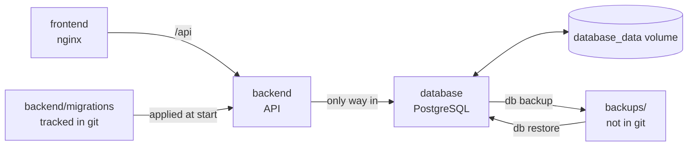
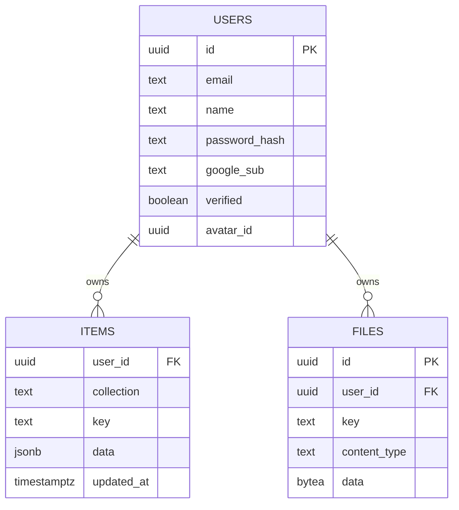
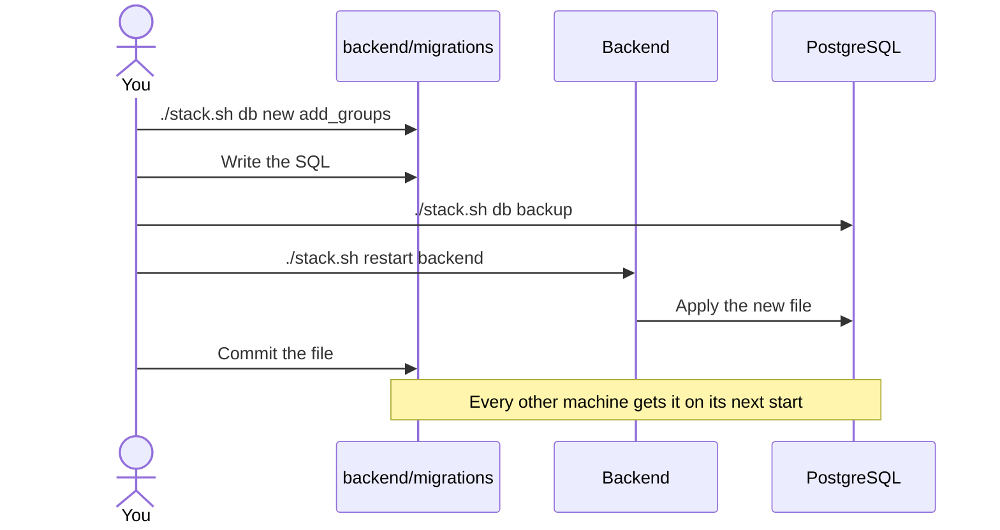
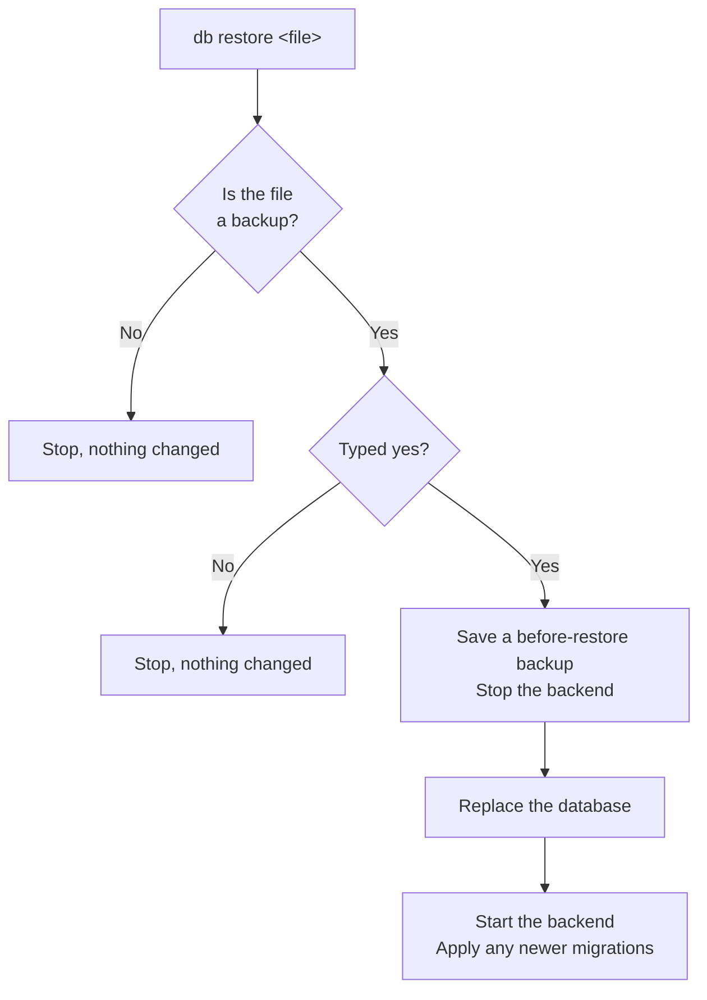

# Database

All app data lives in PostgreSQL, in its own container: accounts, workouts, programs, settings, progress photos and profile pictures. The container has no published port, so only other containers can reach it.

Rebuilding or removing the container doesn't touch the data, because it's in the `database_data` volume.

## What's stored

Everything the app syncs is one row in `items`, with `collection` saying what kind it is:

| Collection | Holds |
| --- | --- |
| `sessions` | Finished workouts |
| `routines` | Programs and their days |
| `exercises` | Custom exercises |
| `programs` | Curated and imported programs |
| `body_stats` | Body measurements |
| `photos` | Progress photo details |
| `scheduled_days` | Workouts planned for a date |
| `exercise_records` | Best lifts and targets |
| `user_state` | Settings, active program, workout in progress |

`files` holds the images themselves. Deleting a user deletes their rows in both tables.

## Looking at the data

| Command | What it does |
| --- | --- |
| `./stack.sh db status` | Show applied migrations and table sizes |
| `./stack.sh db shell` | Open a SQL prompt |
| `./stack.sh db ui` | Browse the database in a web page, on this machine only |

`db ui` prints the address and sign-in details. It runs an extra `adminer` container, which stays running until `./stack.sh down`.

## Changing the structure

The structure lives in numbered SQL files in `backend/migrations`, so it's tracked in git. The backend applies new ones each time it starts, each in a transaction, and records them in `schema_migrations`. A failed migration is rolled back and the backend won't start, and its logs name the file.

Don't edit a migration that has already run, because it won't run again. Add a new one. There's no automatic undo, so take a backup first.

## Backups

| Command | What it does |
| --- | --- |
| `./stack.sh db backup [name]` | Save the database to `backups/` |
| `./stack.sh db restore` | List backups |
| `./stack.sh db restore <file>` | Replace the database with a backup |
| `./stack.sh db reset` | Erase the database |

This is the only copy of everyone's data, and nothing backs it up automatically, so back up regularly and keep copies off this machine. A backup includes photos and runs while the app is in use. `backups/` is ignored by git because it holds real user data.

`restore` and `reset` both ask you to type `yes` and save a backup first, named `before-restore-…` or `before-reset-…`. After a reset the backend recreates the empty structure.

## Changing things later

| To change | Do this |
| --- | --- |
| Tables and columns | Add a migration |
| PostgreSQL minor version | Happens on `./stack.sh rebuild database` |
| PostgreSQL major version | See below |
| Database name or user | Set `POSTGRES_DB` and `POSTGRES_USER` in `.env` before first start |
| Move to a hosted PostgreSQL | Point `DATABASE_URL` in `compose.yaml` at it, then restore a backup there |
| Move to another database | Replace `backend/src/db.js` and the SQL in the backend |
| Move images to file storage | Replace the `files` queries in `backend/src/server.js` |

To change the PostgreSQL major version, its data files need converting, so go through a backup:

1. Run `./stack.sh db backup upgrade`.
2. Run `./stack.sh down`, then `docker volume rm veylith_database_data`. This deletes the database, so check the backup exists first.
3. Set `POSTGRES_VERSION` in `.env`.
4. Run `./stack.sh rebuild`, then `./stack.sh db restore backups/upgrade.dump`.

`POSTGRES_PASSWORD` is only read when the database is first created. Changing it in `.env` afterwards stops the backend connecting, so change it in the database too.
