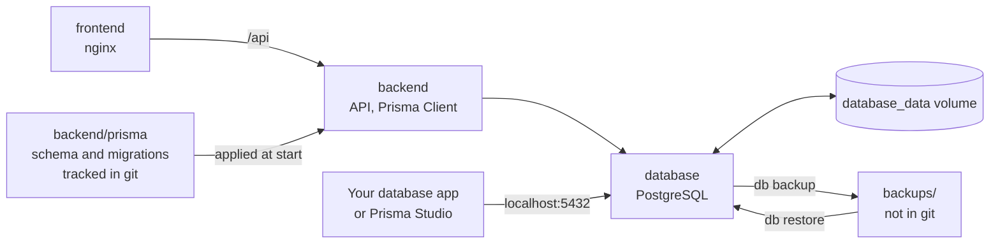
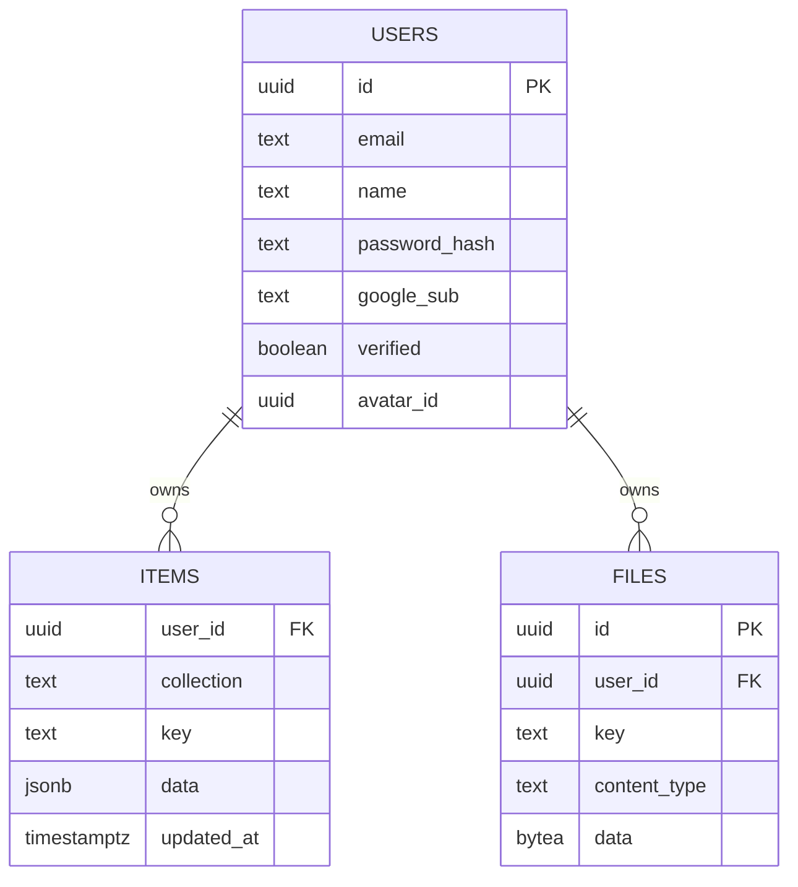
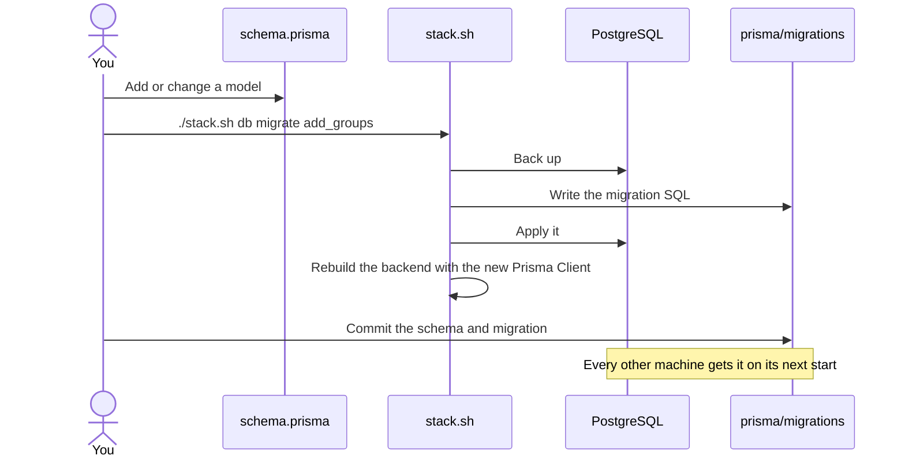
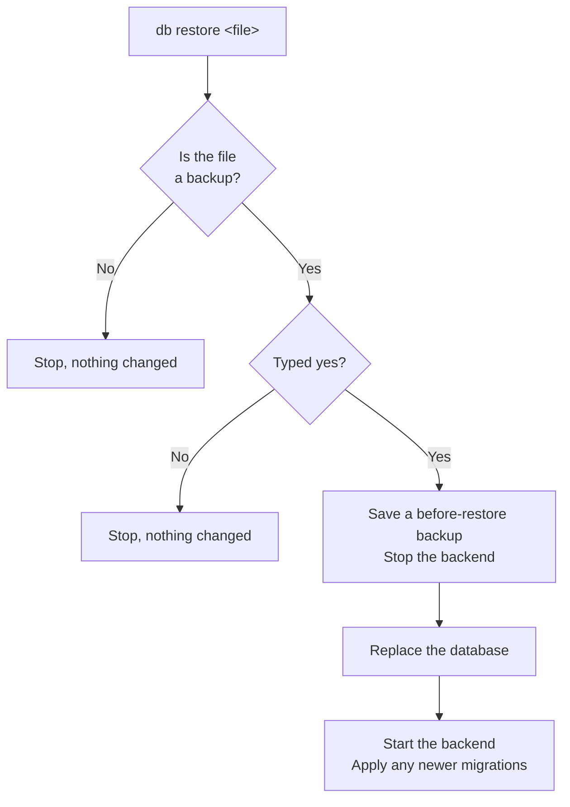

# Database

All app data lives in PostgreSQL, in its own container: accounts, workouts, programs, settings, progress photos and profile pictures. The backend reads and writes it through [Prisma](https://www.prisma.io), and the structure is defined in `backend/prisma/schema.prisma`.

The database port is published on this machine only (`127.0.0.1:5432`), so your own database apps can connect, but other devices can't.



Rebuilding or removing the container doesn't touch the data, because it's in the `database_data` volume.

## What's stored



Everything the app syncs is one row in `items`, with `collection` saying what kind it is:

| Collection | Holds |
| --- | --- |
| `sessions` | Finished workouts |
| `routines` | Programs and their days |
| `exercises` | Custom exercises |
| `programs` | Curated and imported programs |
| `body_stats` | Body measurements |
| `photos` | Progress photo details |
| `scheduled_days` | Workouts planned for a date |
| `exercise_records` | Best lifts and targets |
| `user_state` | Settings, active program, workout in progress |

`files` holds the images themselves. Deleting a user deletes their rows in both tables. Prisma also keeps its own `_prisma_migrations` table, which records the migrations applied.

In the code, the same tables are `User`, `Item` and `File`, with camelCase fields such as `passwordHash`.

## Looking at and changing the data

| Command | What it does |
| --- | --- |
| `./stack.sh db url` | Show the details for your own database app |
| `./stack.sh db studio` | Open Prisma Studio at http://localhost:5555 |
| `./stack.sh db shell` | Open a SQL prompt |
| `./stack.sh db status` | Show migrations, and the exact rows and size of each table |

**Your own app:** any PostgreSQL client works, such as DBeaver, TablePlus, Beekeeper Studio or the PostgreSQL extension for VS Code. Connect to `localhost`, port `5432`, database and user `veylith`. The password is `POSTGRES_PASSWORD` in `.env`.

**Prisma Studio** runs until `./stack.sh down`. It shares this machine's network, because Studio only listens on localhost. That works on Docker in WSL. On Docker Desktop, host networking has to be turned on in its settings.

Edits made directly in the database reach the app on its next sync, as long as the device hasn't changed the same item in the meantime: a device's own unsynced change wins. Keep `data` in the same shape the app writes, because the app reads it as it is.

## Changing the structure

The structure is in `backend/prisma/schema.prisma`, and each change becomes a migration in `backend/prisma/migrations`, both tracked in git. The backend applies new migrations each time it starts.



For example, to add a nickname to accounts, add this line to the `User` model and run `./stack.sh db migrate add_nickname`:

```prisma
  nickname     String?
```

- **Check the SQL:** Prisma writes the migration from the difference, so read it before committing. A rename looks like a removed column plus a new one, which loses that column's data. Edit the SQL by hand to rename instead.
- **Data loss warnings:** if a change would lose data, Prisma asks before applying it.
- **Don't edit an applied migration:** it won't run again. Make another change instead.
- **No automatic undo:** `db migrate` takes a backup first, named `before-migrate-…`, so restore that to go back.

`0_init` is the starting structure. The backend records it as already applied on a database created before Prisma, so older backups still restore.

## Backups

| Command | What it does |
| --- | --- |
| `./stack.sh db backup [name]` | Save the database to `backups/` |
| `./stack.sh db restore` | List backups |
| `./stack.sh db restore <file>` | Replace the database with a backup |
| `./stack.sh db reset` | Erase the database |

This is the only copy of everyone's data, and nothing backs it up automatically, so back up regularly and keep copies off this machine. A backup includes photos and runs while the app is in use. `backups/` is ignored by git because it holds real user data.

`restore` and `reset` both ask you to type `yes` and save a backup first, named `before-restore-…` or `before-reset-…`. After a reset the backend recreates the empty structure.



## Changing things later

| To change | Do this |
| --- | --- |
| Tables and columns | Edit `schema.prisma`, then `./stack.sh db migrate <name>` |
| PostgreSQL minor version | Happens on `./stack.sh rebuild database` |
| PostgreSQL major version | See below |
| Prisma version | Change the three `prisma` packages in `backend/package.json` together, then `./stack.sh rebuild backend` |
| Port for your own app | Set `POSTGRES_PORT` in `.env` |
| Database name or user | Set `POSTGRES_DB` and `POSTGRES_USER` in `.env` before first start |
| Move to a hosted PostgreSQL | Point `DATABASE_URL` in `compose.yaml` at it, then restore a backup there |
| Move to MySQL or SQLite | Change the provider in `schema.prisma`, start the migrations afresh, and move the data across |
| Move images to file storage | Replace the `File` queries in `backend/src/server.js` and `backend/src/db.js` |

To change the PostgreSQL major version, its data files need converting, so go through a backup:

1. Run `./stack.sh db backup upgrade`.
2. Run `./stack.sh down`, then `docker volume rm veylith_database_data`. This deletes the database, so check the backup exists first.
3. Set `POSTGRES_VERSION` in `.env`.
4. Run `./stack.sh rebuild`, then `./stack.sh db restore backups/upgrade.dump`.

`POSTGRES_PASSWORD` is only read when the database is first created. Changing it in `.env` afterwards stops the backend connecting, so change it in the database too.
