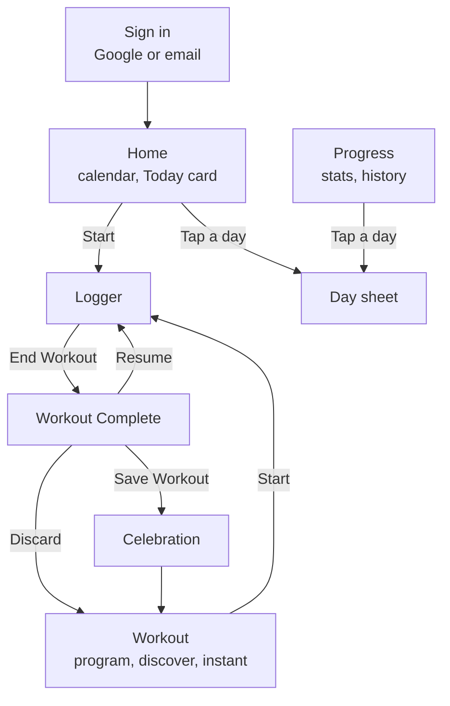
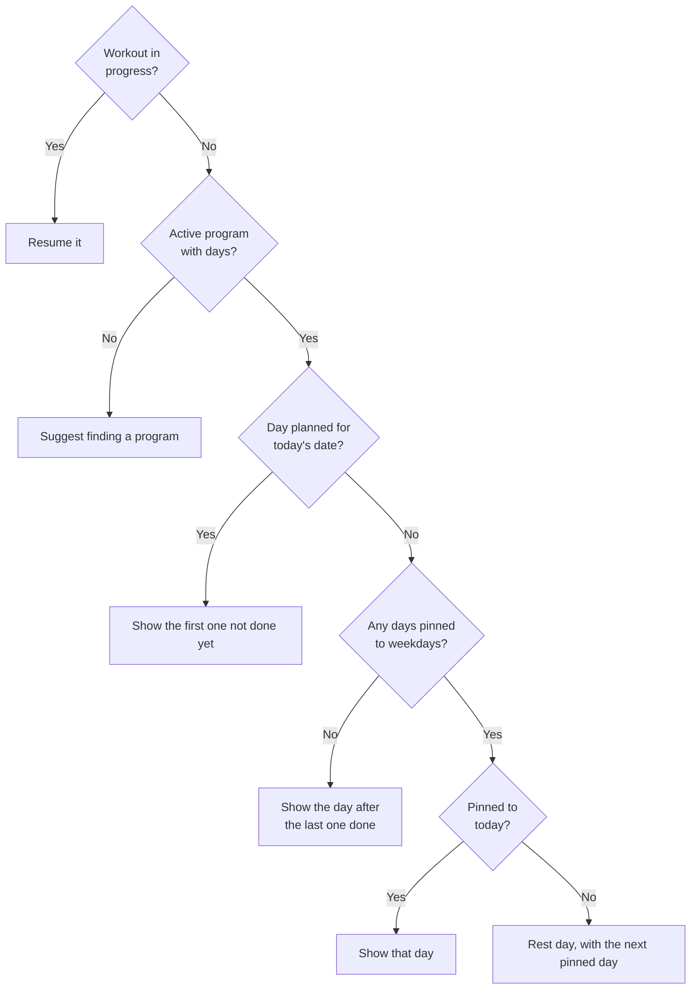
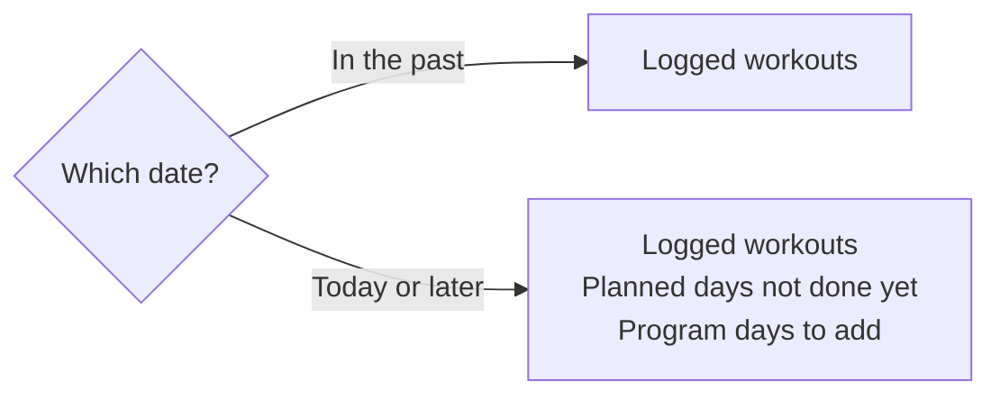
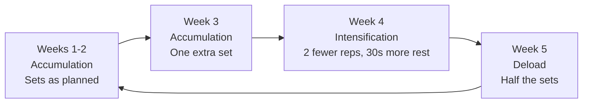
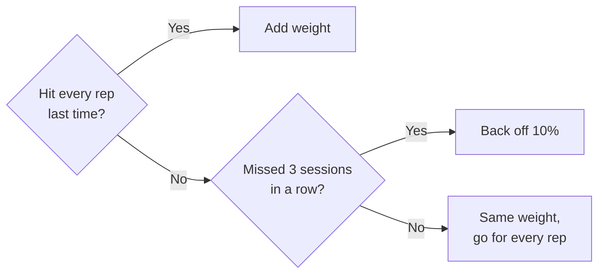
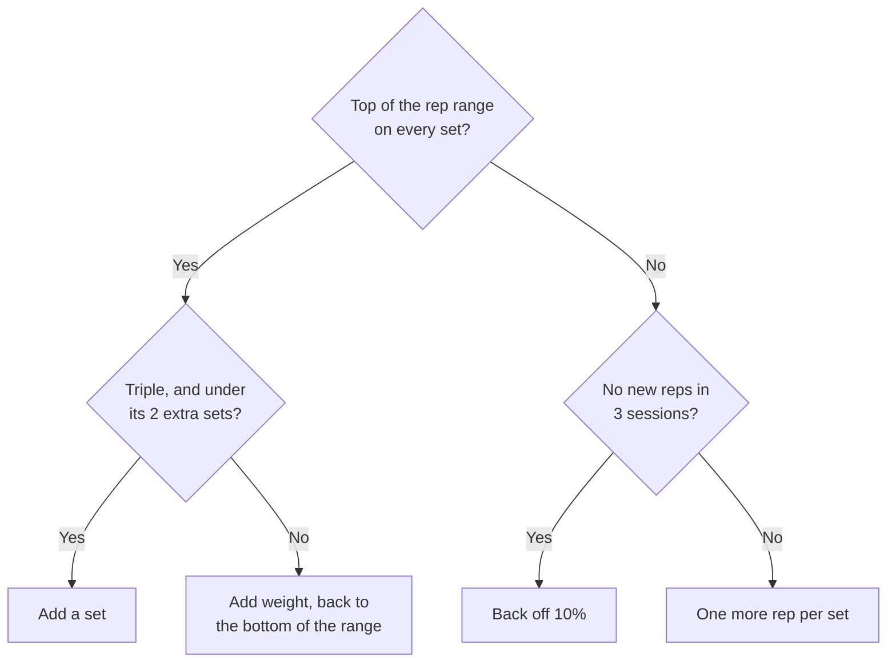
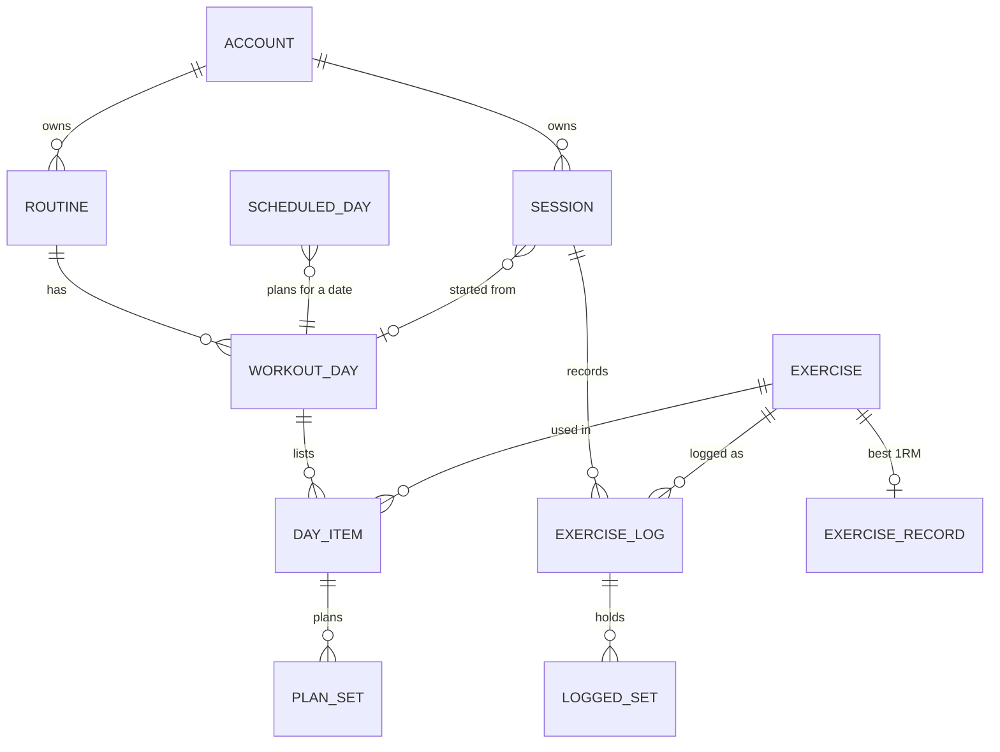

# Features

## Flow

Three tabs: **Home · Workout · Progress**.

- **Home**: a week or month calendar that moves through any past or future date (done days dotted, planned days ringed; tap a day to see what was logged or planned, and from today on to plan a program day for that date), a *Today* card that starts the day planned for today or the next plan day (weekday-pinned days follow the calendar, otherwise the plan rotates) or resumes a running workout, streak chip, exercise search and train-by-muscle.

- **Workout → Program**: plan banner (`•••` menu, *All Plans*), *Overview* of day cards (drag handle to reorder, muscle thumbnail, weekday badge, `Est. 1h 5m, 6 exercises`, last done / *In progress*), *Add a day*. *Day Details* lists each exercise as `3 × 8,10,12 reps`, with a muscles-worked sheet and *Start Workout*.
- **Workout → Discover**: *For You* adaptive plan card (5-week mesocycle: Accumulation ×3 → Intensification → Deload, applied to sets/reps automatically), *Category* row (Muscle Gain, Fat Loss, Push/Pull, Abs, Full Body, At Home, 3 Day Split, Stretch) with a *Filter* sheet (search, goal, level, days/week, location, muscles, sort), *Trending* carousel, *My Plans*. Category pages list plans as `Beginner • Maintaining • 5 Days`; plan detail has goal/level/days pills, equipment, collapsible days with *View All*, share, *Select as Current Plan* and *Build for me* (fits a plan to your days, gym/home equipment and level). **Instant**: pick muscles and a time budget to generate a one-off workout.
- **Logger** (one exercise per screen): segmented progress for all exercises (tap or swipe), 1RM, *Rest* and *Interval* chips, big `Set | Lbs | Reps` table with the current set highlighted, set-type popover (Working / W Warm-up / D Drop / F Failure), add/delete sets. After *Log Set* the footer shows the rest countdown with *Skip rest*; the *Rest* chip opens the inline timer (±15s, pause, restart, edit). Supersets alternate exercises and rest after the round.
- **Active workout bar** above the tabs: elapsed time (or rest countdown), current exercise, *End Workout*.
- **Workout Complete!**: editable name, duration, volume, new records, sets, RPE, front/back muscle map, per-exercise `Weight x reps | 1RM` tables, *Save workout changes* (write today's numbers back to the plan), discard, *Save Workout*.
- **Celebration**: Nth-workout chip, shareable cards (volume comparison, month calendar, muscle split, exercise list).
- **Progress**: stats, calendar, muscle recovery, body weight, records, history. Progress has stat tiles, progress photos (front/side/back, stored on the device as resized JPEGs with location data stripped; before/after slider compare with days apart and weight change), a 12-month activity heatmap (tap a day for its workouts) and a body-weight chart with a goal line.

- **Progression** (per routine: Off / Linear / Double / Triple): each exercise opens with a target worked out from your history and a one-line reason ("Hit 12 on every set, so 5 lb more"). Missed reps never add load; stalls trigger a 10% deload. Workout Complete shows *Last time* and *Next time* per lift.
- **Logger extras**: last-time line, plates per side for barbell lifts (tap for a plate diagram; bar and owned plates in Settings), *Add warm-up sets* ramp, per-set RIR/RPE, swipe a set left to delete (Undo) or right to copy, −/+ steppers under the current set (hold to repeat), and the area below the hero follows your finger when swiping between exercises. Screen stays awake during a workout and flashes when rest ends.
- **Muscles card** on Progress: Recovery (hard sets fading with a per-muscle half-life), Volume (Week / 30d / 90d) and Untrained.

Exercise illustrations: 64 exercises show a start/end pose line drawing that eases between the two (logger hero and exercise page), from [Everkinetic](https://github.com/everkinetic/data), CC BY-SA 4.0 (see `frontend/public/ek/LICENSE.txt`; credited in Settings → About). Exercises without one show the body map.

Body maps are SVG; theme is navy with an orange accent.

## Planning

The *Today* card picks one thing to show:

Tapping a day on the calendar shows what fits that date:

## Adaptive plans

Adaptive plans repeat a 5-week cycle:

## Progression

How each exercise's next target is worked out from your last session. With the rule set to Off, or no history yet, the plan is used as written. In a deload week, any other rule goes about 10% lighter instead. Bodyweight exercises with no added weight gain a rep per set.

**Linear:**

**Double and Triple:**

## Data

Sign in with Google, or with an email and password. Each account has a name and profile picture, editable in Settings. Data is stored in your account on the [backend](backend.md), and each device keeps a copy so the app works without a connection and catches up afterwards. Data already on a device uploads on first sign-in. Settings → Data exports/imports a JSON backup of everything, including progress photos.

Weights are stored in pounds and converted for display. Body stats and progress photos stand alone, keyed by date.
